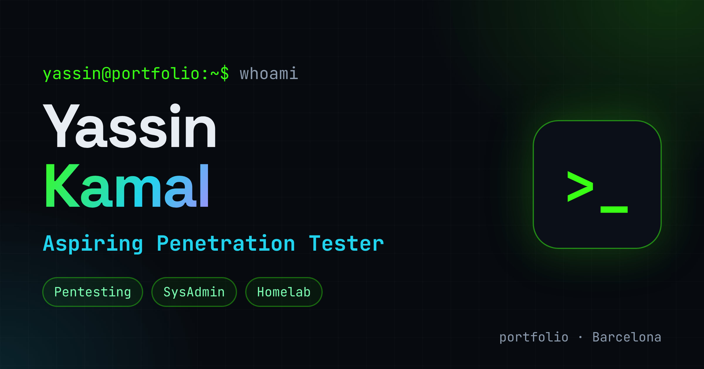

# Yassin Kamal — Portfolio

Personal portfolio of **Yassin Kamal**, systems administration (ASIX) student and aspiring penetration tester.

🔗 **Live:** https://portfolio-sand-eight-20.vercel.app



## Features
- Bilingual (English / Español) with a language toggle
- Animated terminal and typing effect in the hero
- Featured project **NoSub** with an architecture diagram
- Responsive (mobile-first), with scroll-reveal animations
- Pure **HTML + CSS + JavaScript** — no frameworks, no build step

## Structure
```
index.html        → page, styles and scripts
img/profile.jpg   → profile photo
```

## Run locally
Open `index.html` in your browser.

## Deploy
Deployed on [Vercel](https://vercel.com) as a static site.
